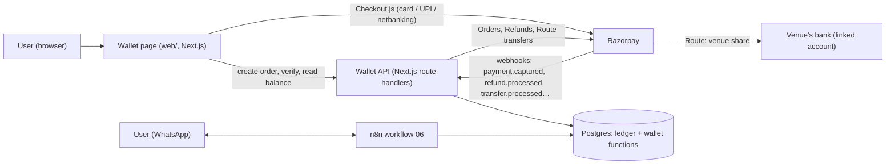
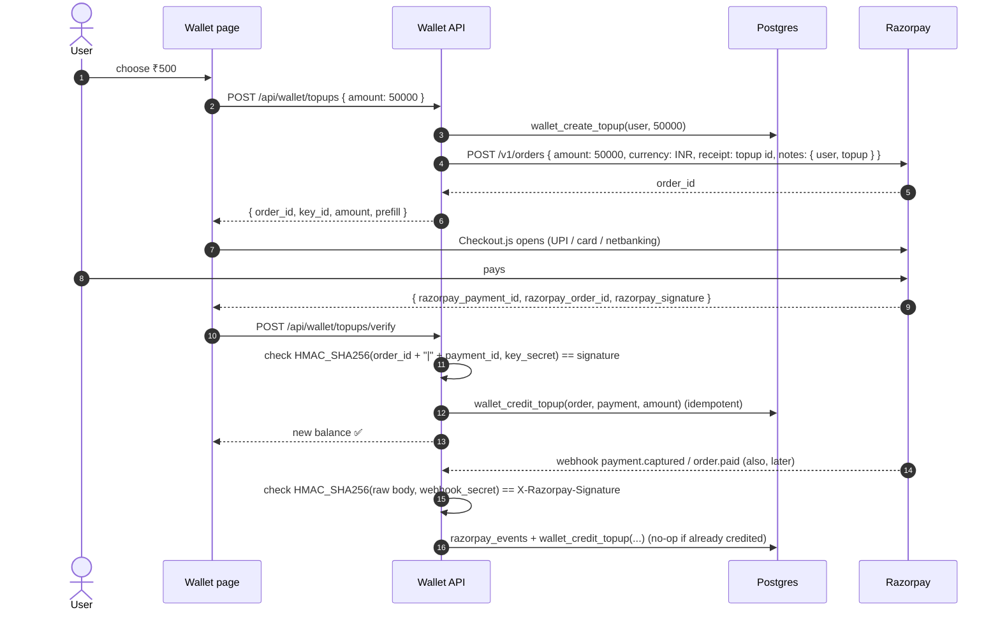

# Tori payments: credit wallet and Razorpay split payments

Status: **step 1 built (2026-10-18)**:
- the prepaid ledger in this repo's Postgres (not Supabase);
- WhatsApp "add credits" → a one-time link → the `/wallet` page with Razorpay test-mode top-ups (callback +
  webhook, credited once);
- one-tap checkout through `POST /webhook/wallet/charge` and [Pay ₹X] on WhatsApp.

See README → "Tori Wallet" and Architecture.md §21.

**Step 2 built (2026-10-20): ToriPay.** "tori pay gym 500" on WhatsApp pays a verified business from the
wallet:
- the team adds businesses with their bank details (account number sent to RazorpayX only);
- people keep shortcuts ("gym", "gym edit", "my payees");
- payouts go out through RazorpayX when `RAZORPAYX_ACCOUNT_NUMBER` is set (payouts are not activated on
  the current account yet); until then payments stay owed in the ledger and the team settles them by bank
  transfer;
- a failed payout refunds the person in full.

See README → "ToriPay" and Architecture.md §22. The money flow is still collect → hold → pay out (not
Route), so the wallet's PPI question in §2 covers it too.

Not built yet: Route split payments (§7), bonus credits, refunds to the card or UPI, and the wiring into the
original Supabase venue-booking flow (it should call the charge webhook instead of creating a payment link).
The design below still applies to those.

Goal: a **universal wallet**. People buy **Tori credits** once and use them for any Tori service: court
and turf bookings, gyms, coaching, and later partner games and cab shares. Money for a booking is then
**split automatically** between the venue and Tori through Razorpay Route.

The first deliverable is a web page where a user logs in, adds credits by paying with Razorpay, and sees
their balance and history. Spending credits from the WhatsApp bot comes next.

Contents:
[0 Requirements](#0-requirements-confirmed-vs-assumed) · [1 Today](#1-what-exists-today) ·
[2 Compliance](#2-compliance-read-before-building) · [3 Architecture](#3-architecture) ·
[4 Ledger](#4-the-ledger-data-model) · [5 Top-up](#5-flow-adding-credits) ·
[6 Spending](#6-flow-paying-with-credits) · [7 Split payments](#7-flow-split-payments-razorpay-route) ·
[8 Refunds](#8-refunds-cancellations-disputes) · [9 Web page](#9-the-wallet-web-page) ·
[10 WhatsApp](#10-whatsapp-integration) · [11 API](#11-api) · [12 Security](#12-security-and-correctness) ·
[13 Testing](#13-testing) · [14 Plan](#14-implementation-plan) · [15 Questions](#15-open-questions)

---

## 0. Requirements: confirmed vs assumed

**Confirmed**

| # | Requirement |
|---|---|
| C1 | Razorpay is the payment gateway |
| C2 | A universal wallet: one balance per person, usable across Tori services |
| C3 | A credit system: credits are bought with real money and spent later on Tori bookings |
| C4 | A web page to add credits by paying |
| C5 | Automated split payments (venue share + Tori share) through Razorpay |

**Assumed (decide before building)**

| # | Assumption | Why |
|---|---|---|
| A1 | **1 credit = ₹1**, stored as integer **paise** | No conversion bugs, easy to read on receipts |
| A2 | Paid credits **don't expire** and **can't be withdrawn** as cash; unused paid credits can be refunded to the original payment method on request | Keeps Tori a closed wallet (§2); refund-on-request is fair and common |
| A3 | Bonus credits ("add ₹1,000, get ₹50 extra") are a separate bucket: they expire (e.g. 90 days), are never refunded, and are spent before paid credits | Promotions shouldn't become a refund liability |
| A4 | Tori is the **seller (merchant of record)** of every booking paid with credits; venues are paid their share by Tori | Needed for the closed-wallet model (§2) and for Route |
| A5 | Login on the web is **WhatsApp-verified**: the page shows a code, the user sends it to the bot | Same pattern as `JOIN <code>`; no passwords, no SMS OTP cost |
| A6 | Minimum top-up ₹100, maximum ₹10,000 per top-up, wallet cap ₹10,000 | Limits fraud and stays well inside small-wallet rules (verify in §2) |
| A7 | Postgres (this repo's database) is the source of truth for balances; Razorpay is the source of truth for money movement | Every balance change is a ledger entry linked to a Razorpay ID |

---

## 1. What exists today

The original WhatsApp bot (workflow 06, inherited export) already uses Razorpay:

- **Razorpay Payment Links** (`POST /v1/payment_links`) are created per booking and sent on WhatsApp
  ("Pay now").
- A `Payment Webhook` (`/razorpay-webhook`) marks the booking paid in Supabase tables
  (`beforepaymentbookingdetails`, `appointments`).
- Several copies of these nodes are disabled, and the key and secret were hardcoded in the export.

There is no wallet, no ledger, no refund handling and no split payment. This design leaves those booking
flows working and adds the wallet next to them. Once credits work, "Pay now" becomes "Pay with credits
or UPI/card".

---

## 2. Compliance (read before building)

This needs a CA / lawyer's sign-off before going live. The points below shape the design.

- **RBI prepaid payment instruments (PPI) rules.** A wallet usable **only for the issuer's own goods and
  services** is a *closed-system PPI*, which doesn't need RBI authorisation. A wallet usable at
  **third-party merchants** is a *semi-closed PPI*, which needs RBI authorisation and KYC.
  - That's why A4 matters: credits must buy **Tori's** service (Tori sells the booking and pays the venue
    afterwards), never pay a venue directly.
  - No cash-out (A2) is also part of staying closed-system.
- **GST.** Prepaid credits are usually treated as a voucher: GST applies when the credit is **used** for
  a service, not when it is bought. Tori's commission is a taxable service.
- **TCS (GST section 52).** If Tori collects money on behalf of venues as an e-commerce operator, it may
  have to collect TCS on payouts to venues and file returns.
- **Refunds.** Refunds go to the original payment method; RBI expects failed-transaction refunds within
  set timelines.
- **Data.** Razorpay Checkout keeps card and UPI data out of our systems (PCI scope stays with Razorpay).
  Store only Razorpay IDs.

---

## 3. Architecture



| Piece | Job |
|---|---|
| **Wallet page** (`web/`, new routes `/wallet`, `/login`) | Login with WhatsApp, balance, buy credits, history |
| **Wallet API** (Next.js route handlers in `web/`, server-side only) | Creates Razorpay orders, verifies payment signatures, receives webhooks, calls the SQL functions. The only place that holds the Razorpay key secret |
| **Postgres** | Ledger, balances and every rule, as SQL functions (same style as the bot: one transaction per call) |
| **n8n workflow 06** | "balance", "add credits" link, "Pay with credits" in booking flows; calls the same SQL functions |
| **Razorpay** | Orders + Checkout (top-ups), Refunds, Route (linked accounts and transfers to venues), webhooks |

Why the API lives in `web/` and not n8n:
- Payment signature checks need the raw request body.
- The key secret should sit in one small, testable server.
- The page needs a session.

n8n keeps handling WhatsApp; it never touches card data or the key secret.

---

## 4. The ledger (data model)

Balances are **never stored and updated in place**. Every change is a balanced journal entry; a balance is
the sum of its postings. This makes double credits, lost money and "where did ₹200 go" impossible to hide.

```sql
-- one row per thing that moves value
wallet_journal (
  id            uuid PK,
  kind          text,      -- topup | spend | refund_to_wallet | refund_to_source | payout | bonus | bonus_expiry | adjustment
  ref_type      text,      -- topup | booking | refund | transfer | admin
  ref_id        text,      -- e.g. Razorpay payment / refund / transfer id, booking id
  idempotency_key text UNIQUE,   -- e.g. 'topup:pay_ABC123' → the same webhook twice posts once
  created_at    timestamptz,
  created_by    text       -- 'razorpay-webhook', 'web', 'bot', 'admin:<name>'
)

-- the legs of each entry; amounts in paise, they sum to 0 per journal
wallet_postings (
  journal_id    uuid FK,
  account       text,      -- see accounts below
  amount_paise  bigint     -- + credit to the account, − debit
)
-- check: SUM(amount_paise) = 0 per journal_id (enforced in the posting function)

wallet_accounts (           -- one row per account, for locking and limits
  account       text PK,    -- 'user:<user_id>:paid', 'user:<user_id>:bonus', 'user:<user_id>:held',
                            -- 'tori:razorpay_clearing', 'tori:revenue', 'tori:promo_expense',
                            -- 'venue:<venue_id>:payable', 'tori:gst_payable'
  owner_user_id uuid NULL,
  kind          text,
  min_balance   bigint DEFAULT 0   -- user accounts can't go below 0
)

wallet_topups (
  id               uuid PK,
  user_id          uuid FK → tori_users,
  amount_paise     bigint CHECK (amount_paise BETWEEN 10000 AND 1000000),
  bonus_paise      bigint DEFAULT 0,
  rzp_order_id     text UNIQUE,
  rzp_payment_id   text UNIQUE NULL,
  status           text,   -- created | paid | failed | refunded
  created_at, paid_at
)

razorpay_events (           -- every webhook, stored before it is processed
  event_id     text PK,     -- x-razorpay-event-id header: a replay is ignored
  event        text,        -- payment.captured, order.paid, refund.processed, transfer.processed …
  payload      jsonb,
  received_at  timestamptz,
  processed_at timestamptz NULL,
  error        text NULL
)

linked_accounts (            -- venues paid through Razorpay Route
  venue_id           bigint FK → tori.venue,
  rzp_account_id     text UNIQUE,    -- acc_XXXX
  status             text,           -- created | under_review | activated | suspended
  commission_bps     int             -- e.g. 1000 = 10 % kept by Tori
)

payouts (                    -- one Route transfer to a venue
  id, booking_id, venue_id, amount_paise, rzp_transfer_id UNIQUE, on_hold_until, status
)
```

**How a booking of ₹500 paid with credits posts** (Tori keeps 10 %):

| Account | Amount |
|---|---|
| `user:42:paid` | −500.00 |
| `venue:7:payable` | +450.00 |
| `tori:revenue` | +50.00 |

When Route pays the venue: `venue:7:payable −450`, `tori:razorpay_clearing −450`.

**Functions** (SQL, one transaction each, row lock on the user's wallet account so two spends can't race):

| Function | Does |
|---|---|
| `wallet_balance(user)` | paid, bonus, held, and the usable total |
| `wallet_create_topup(user, amount)` | validates limits, inserts `wallet_topups` (status `created`); the API then creates the Razorpay order |
| `wallet_credit_topup(rzp_order_id, rzp_payment_id, amount)` | idempotent: marks the top-up paid and posts `tori:razorpay_clearing → user:paid` (+ bonus); checks the amount matches the order |
| `wallet_hold(user, amount, booking)` / `wallet_capture(hold)` / `wallet_release(hold)` | reserve credits while a booking is being confirmed, then spend or give back |
| `wallet_spend(user, amount, booking, venue)` | bonus first, then paid; posts the venue and Tori shares; fails if the balance is too low |
| `wallet_refund_to_wallet(booking)` | cancellation → credits back |
| `wallet_refund_to_source(topup, amount)` | unused paid credits back to the card/UPI (calls Razorpay Refunds) |
| `wallet_expire_bonus()` | scheduled: expired bonus credits → `tori:promo_expense` |

---

## 5. Flow: adding credits



- **Two paths credit the wallet:** the browser callback (fast, so the user sees the balance at once) and
  the webhook (reliable, even if the tab was closed). The idempotency key `topup:<payment_id>` means
  only the first one posts.
- **The amount always comes from our `wallet_topups` row**, never from the browser.
- **Payments must be captured.** Turn on auto-capture in the Razorpay dashboard, or capture explicitly
  in the webhook handler; Razorpay refunds authorised-but-uncaptured payments automatically.
- **`payment.failed`** marks the top-up failed; nothing is credited.

---

## 6. Flow: paying with credits

From WhatsApp (bot booking flow) or the web:

1. The service price is known server-side (venue, slot, price list).
2. `wallet_hold(user, price, booking)` reserves credits. If the balance is too low, the bot offers
   **"Add credits"** (link to the wallet page) or **"Pay ₹X by UPI"**: the existing payment-link flow
   for the difference.
3. The booking is confirmed (slot reserved, calendar event, venue notified).
4. `wallet_capture` posts the spend: the user pays, the venue's share goes to `venue:<id>:payable`, Tori's
   commission to `tori:revenue`.
5. If confirmation fails: `wallet_release`, and the credits return.

**Mixed payment** (₹300 credits + ₹200 UPI): hold ₹300, create a Razorpay order for ₹200, capture both
when the order is paid.

---

## 7. Flow: split payments (Razorpay Route)

Razorpay **Route** pays third parties out of payments Tori receives.

- Each venue becomes a **linked account**: created through the API or dashboard, with KYC and bank
  details; Razorpay activates it.
- Tori then creates **transfers** to it.
- **Hold funds until the game happens**, using a transfer's `on_hold` / `on_hold_until`. Transfers are
  released after the slot time plus a dispute window, and reversed if the booking is cancelled first.

There are two money paths:

| Paid with | Transfer created |
|---|---|
| **UPI / card for a booking** (Razorpay order) | Transfers attached to the order (`transfers: [{ account: acc_X, amount: venue share, on_hold: 1 }]`), or `POST /v1/payments/{id}/transfers` after capture |
| **Credits** (money was already captured at top-up) | **Direct transfer** from Tori's Razorpay balance to the linked account (`POST /v1/transfers`, needs Razorpay to enable direct transfers). Done in a daily batch from `venue:<id>:payable`, which needs fewer transfers and is easier to reconcile |

Webhooks `transfer.processed`, `transfer.failed` and `settlement.processed` update `payouts` and post
`venue:<id>:payable → tori:razorpay_clearing`.

The split percentage is `linked_accounts.commission_bps`, per venue. GST on the commission is posted to
`tori:gst_payable` (§2).

---

## 8. Refunds, cancellations, disputes

| Case | What happens |
|---|---|
| Booking cancelled within policy | Credits back to the wallet (`wallet_refund_to_wallet`); the held Route transfer is reversed |
| User asks to refund unused paid credits | `wallet_refund_to_source`: a Razorpay refund on the original top-up payment(s), newest first; bonus credits are not refunded |
| Top-up paid, but the wallet never credited (crash) | Webhook replay plus a nightly reconciliation job: Razorpay payments vs `wallet_topups` |
| Chargeback / dispute on a top-up | Freeze the wallet; debit what is left; a negative balance is flagged for manual review |
| Venue cancels | Full credit refund; the venue's transfer is reversed |
| Duplicate webhook | `razorpay_events.event_id` and the journal's `idempotency_key` make it a no-op |

---

## 9. The wallet web page

A new section in the existing board app (`web/`), same design (Manrope, Tori colours):

- **`/login`:**
  1. The page shows a code: *"Send `LOGIN 7K2Q` to Tori on WhatsApp"*, with a button that opens WhatsApp
     with it typed out.
  2. The bot verifies the number (`tori_login_confirm`) and the page, polling every 2 s, gets a session
     cookie (httpOnly, 30 days).
  3. The code is single-use, expires in 10 minutes, and is bound to that browser.
- **`/wallet`:**
  - **Balance card:** total, split into paid and bonus (with bonus expiry).
  - **Add credits:** packs (₹200, ₹500, ₹1,000 with +5 % bonus, ₹2,000 with +10 % bonus) or a custom
    amount, then **Pay with Razorpay** (Checkout.js), then *"✅ 500 credits added"*.
  - **History:** top-ups, spends (sport, venue, date), refunds, bonus expiries, each with its Razorpay
    reference.
  - **Refund unused credits:** a request form (A2).
- **WhatsApp link:** "add credits" in the bot sends a one-time link that logs straight in (a signed
  token, 15 minutes, single use).

---

## 10. WhatsApp integration

| User sends / taps | Bot does |
|---|---|
| "balance", "credits", "wallet" | "💳 You have 750 credits (₹750). Add more: <link>" |
| "add credits" | one-time login link to `/wallet` |
| "LOGIN 7K2Q" | confirms a web login (like `JOIN`) |
| booking flow → **Pay with credits** button | hold, then capture (§6); "✅ Paid 500 credits · 250 left" |
| not enough credits | "You have 200 credits. [Add credits] [Pay ₹300 by UPI]" |
| after a top-up (webhook) | "✅ 500 credits added. Balance 750." |

---

## 11. API

All under `web/src/app/api/`, server-side only.

| Method & path | Auth | Does |
|---|---|---|
| `POST /api/login/start` | none | Creates a login code bound to this browser |
| `GET /api/login/status` | browser | Polls; sets the session once the bot confirms |
| `GET /api/wallet` | session | Balance and last 50 history rows |
| `POST /api/wallet/topups` | session | `{ amount_paise }` → creates the top-up and Razorpay order; returns `order_id`, `key_id` |
| `POST /api/wallet/topups/verify` | session | Checks the payment signature and credits (idempotent) |
| `POST /api/wallet/refund-requests` | session | Asks to refund unused paid credits |
| `POST /api/razorpay/webhook` | Razorpay signature | Stores the event, then processes it: `payment.captured`, `payment.failed`, `order.paid`, `refund.processed`, `refund.failed`, `transfer.processed`, `transfer.failed`, `payment.dispute.created` |
| `POST /api/admin/...` | admin key | Adjustments, linked-account onboarding, payout batch, reconciliation report |

**Environment:**
- `RAZORPAY_KEY_ID`, `RAZORPAY_KEY_SECRET`, `RAZORPAY_WEBHOOK_SECRET`;
- `WALLET_SESSION_SECRET`;
- `WALLET_MIN_TOPUP_PAISE`, `WALLET_MAX_TOPUP_PAISE`, `WALLET_MAX_BALANCE_PAISE`.

The key secret is **only** in the web container, never in n8n or the browser.

---

## 12. Security and correctness

- **Money is integers (paise)**, never floats.
- **Every balance change is a journal entry** whose postings sum to 0, enforced in the posting function.
  A nightly check asserts that every journal sums to 0 and no user account is negative.
- **Idempotency everywhere:** Razorpay event IDs, `topup:<payment_id>`, `spend:<booking_id>`,
  `refund:<refund_id>`.
- **Concurrency:** `SELECT … FOR UPDATE` on the user's wallet account row in every spend, hold or
  refund. Two bookings in the same second can't overspend; this is the same lock pattern that passed the
  join race test.
- **Signatures:**
  - payment: `HMAC_SHA256(order_id|payment_id, key_secret)`;
  - webhook: `HMAC_SHA256(raw body, webhook_secret)`;
  - comparisons are constant-time.
- **Amounts and prices are always server-side.** The browser only sends which pack or how many paise,
  checked against limits.
- **Webhooks are stored before processing**, so a crash mid-way is replayed safely.
- **Reconciliation:** a daily job compares Razorpay payments, refunds and transfers (API) with
  `wallet_topups` / `payouts` and alerts on any difference.
- **Audit:** admin adjustments need a reason and are journal entries too; nothing is ever edited or deleted.

---

## 13. Testing

- **Razorpay test mode:**
  - test keys and test cards / UPI (`success@razorpay`, `failure@razorpay`);
  - webhooks to the board tunnel (`scripts/board-tunnel.sh`);
  - Route in test mode with test linked accounts.
- **SQL tests** (same style as `db/tests/*.sql`):
  - top-up credited once even with a replayed webhook;
  - amount mismatch refused;
  - spend can't go negative;
  - 30 parallel spends on one wallet;
  - bonus spent first and expires;
  - refund to wallet / source;
  - every journal sums to 0.
- **End to end:** a mock Razorpay in `mock-apis/` (orders, signature, webhook replay) so CI runs without
  the real gateway.

---

## 14. Implementation plan

| Step | Work | Done when |
|---|---|---|
| 0 | Decisions (§15); CA review of §2; Razorpay account: enable Route and direct transfers; create a webhook secret | Signed-off list |
| 1 | Ledger: tables, posting function, balance, top-up functions; SQL tests | Invariant tests pass |
| 2 | WhatsApp login (`LOGIN <code>`), session, `/wallet` page with balance and history | Log in from a phone, see 0 credits |
| 3 | Top-up: Orders API, Checkout.js, verify endpoint, webhook endpoint (store + process), packs and bonus | Test payment credits the wallet once, even with a replayed webhook |
| 4 | Bot: "balance", "add credits" link, top-up confirmation message | Works from WhatsApp |
| 5 | Spend: hold / capture / release in the booking flows; mixed credits + UPI | Book a court with credits |
| 6 | Route: linked-account onboarding (admin), venue commission, daily payout batch, on-hold until the slot, transfer webhooks | A test venue receives its share |
| 7 | Refunds (to wallet, to source), cancellations, dispute freeze, bonus expiry, reconciliation job, admin reports | Reconciliation clean for a week of test data |
| 8 | Live keys, legal pages (wallet terms, refund policy), monitoring | Go-live |

---

## 15. Open questions

1. **Credit value:** 1 credit = ₹1 (A1)?
2. **Bonus packs:** yes or no, and how much? Should bonus credits expire?
3. **Refunds:** can users get unused paid credits back to their bank or UPI (A2)?
4. **Which services accept credits first:** court and turf bookings only, or gyms, physio and partner
   games too?
5. **Commission:** what percentage Tori keeps per venue, and who pays the gateway fee (about 2 %).
6. **Merchant of record:** is Tori the seller of every booking (needed for a closed wallet), or do venues
   sell directly?
7. **Payout timing:** daily batch, or per booking after the slot time?
8. **Wallet limits:** ₹10,000 cap and ₹100 minimum top-up (A6)?
9. **Login:** is a WhatsApp code enough, or do you also want Google login (ToriGoogle already has it)?
